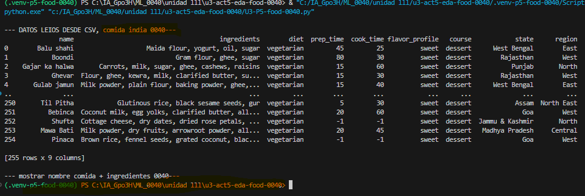
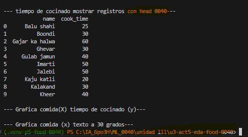
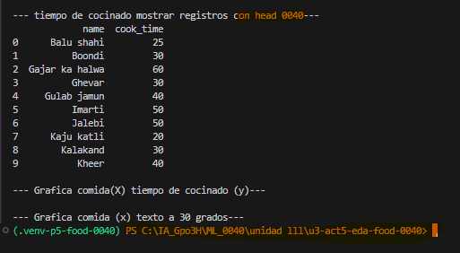
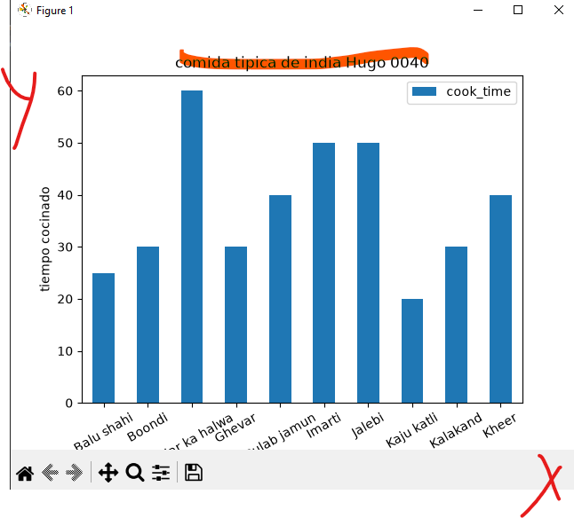
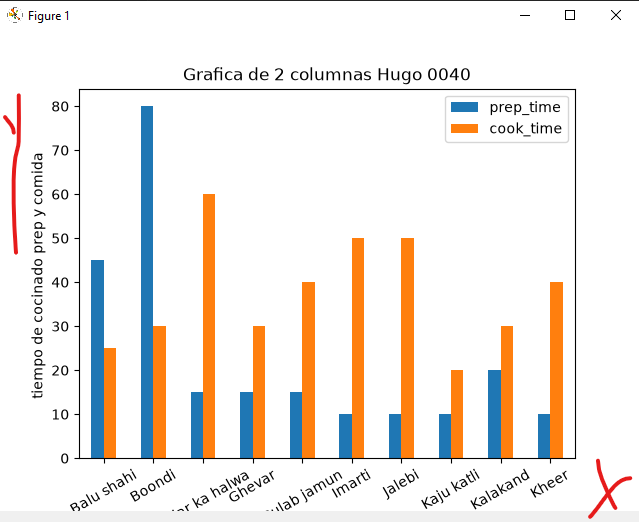
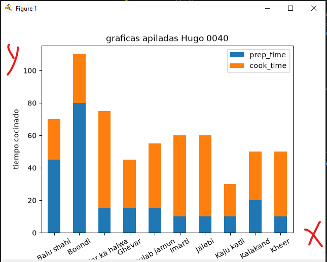

## Analisis exploratorio de datos 
## comida del pais de india
## Hugo Fabian NC 0040
### +-+-+ importando datos del archivo csv comida india 0040

## +-+-+- mostrar comida + ingredientes 0040

## tiempo de cocinado mostrar 10 registros con head

## creacion de graficas de barras

## creacion de grafica de 2 columnas

## Graficas apiladas
